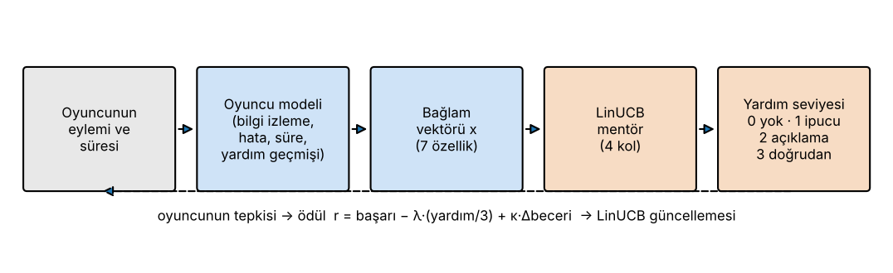
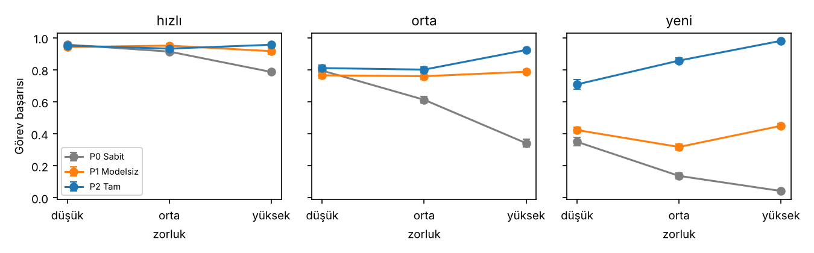
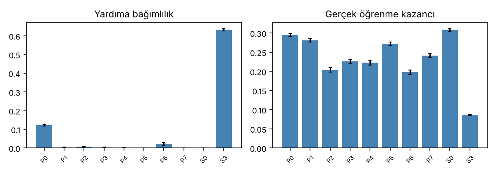

# Adaptive AI Mentor: Endüstriyel Eğitim Oyunu için Adaptif Yardım Politikası

Endüstriyel bir **makine arıza giderme** eğitim oyununda, oyuncuya *ne zaman ve ne kadar yardım verileceğine* karar veren bir yapay zeka mentörünün simülasyon çalışması.

Mentör, oyuncunun durumunu açık bir **oyuncu modeli** ile izler ve dört yardım seviyesinden birini **LinUCB bağlamsal bandit** algoritmasıyla seçer. Amaç, "yardım ikilemi"ni dengelemektir: çok yardım öğrenmeyi azaltır, az yardım oyuncuyu kilitler.

> *Bilgisayar Oyunlarında Yapay Zeka* yüksek lisans dersi kapsamında hazırlanmıştır (Güz 2026, Proje 5: Adaptive AI Mentor for Industrial Training).

---

## Nasıl Çalışır?



1. **Gözlem:** Oyuncu bir adımda eylem yapar. Eylemin doğru olup olmadığı ve ne kadar sürdüğü kaydedilir.
2. **Oyuncu modeli:** Her beceri kategorisi için *Bayesian Knowledge Tracing (BKT)* ile beceri tahmini güncellenir. Bunun yanında son hatalar, tepki süresi ve yardım geçmişi de izlenir.
3. **Bağlam vektörü (7 özellik):** sabit terim, beceri tahmini, son hata oranı, tepki süresi, yardım geçmişi, adım zorluğu, bu adımdaki yanlış sayısı.
4. **Karar:** LinUCB her yardım seviyesini bir *kol* olarak ele alır ve en yüksek güven sınırına sahip seviyeyi seçer:

   | Seviye | Yardım |
   |:-----:|--------|
   | 0 | Yardım yok |
   | 1 | İpucu (ilgili göstergeyi vurgular) |
   | 2 | Açıklayıcı ipucu (ilkeyi anlatır) |
   | 3 | Doğrudan yönlendirme (doğru eylemi söyler) |

5. **Ödül ve güncelleme:**

   ```
   r = başarı − λ · (yardım seviyesi / 3) + κ · Δ(beceri tahmini)
   ```

   Ödül yalnızca gözlenebilir büyüklüklerden hesaplanır. Sentetik öğrenenin gizli parametreleri politikaya hiçbir zaman verilmez. `A⁻¹` matrisi Sherman–Morrison formülüyle güncellenir, yani matris tersi hiç alınmaz.

### Sentetik öğrenen

Gerçek kullanıcı verisi kullanılmaz. Her öğrenenin beceri kategorisi başına gizli bir beceri değeri vardır:

- Doğru yapma olasılığı, *beceri − zorluk* farkının sigmoidine ve seçenek sayısına bağlıdır. Yardım bu olasılığı artırır.
- Az yardımla başarılan adımlarda öğrenme büyük, doğrudan yönlendirmeyle başarılan adımlarda küçüktür (**üretken çaba** ilkesi).
- Yardım alındıkça **yardıma bağımlılık** artar. Bağımlılık arttıkça yardımsız başarı düşer.

Üç profil vardır: **hızlı**, **orta** ve **yeni başlayan**. Zorluk da üç seviyedir: düşük / orta / yüksek (senaryo başına 4 / 6 / 8 adım, adım başına 3 / 4 / 5 seçenek).

---

## Karşılaştırılan Politikalar

| Kod | Politika | Açıklama |
|-----|----------|----------|
| **P0** | Sabit ipucu çizelgesi | *k*. yanlışta *k*. seviye yardım verir, oyuncuya bakmaz (ana baseline) |
| **P1** | Adaptif, oyuncu modelsiz | LinUCB, yalnızca görev bağlamını kullanır (zorluk, yanlış sayısı) |
| **P2** | Tam adaptif mentör | LinUCB, 7 özelliğin tamamını kullanır |
| P3–P6 | Ablation | P2'den sırasıyla beceri / son hatalar / tepki süresi / yardım geçmişi çıkarılır |
| P7 | LinTS | Aynı bağlam ve ödülle doğrusal Thompson örnekleme |
| S0, S3 | Sınır politikaları | Her zaman yardım yok / her zaman doğrudan yönlendirme |

Tüm politikalar **ortak rastgele sayılarla** çalıştırılır: aynı öğrenen, aynı senaryolar ve aynı zar atışları kullanılır. Böylece sonuçlardaki farklar şanstan değil, politikadan kaynaklanır.

---

## Deney Protokolü

| Aşama | Tohumlar | Açıklama |
|-------|----------|----------|
| Eğitim | 0–99 | Politikalar çevrimdışı öğrenir (politika başına 300 episode) |
| Doğrulama | 100–109 | `α, λ, κ` ızgara araması. Seçim ölçütü önceden sabitlendi: `başarı + 2·öğrenme − 0.5·bağımlılık` |
| Test | 1000–1009 | Ağırlıklar dondurulur, açgözlü seçim yapılır. Her yapılandırma için 10 tohum × 30 episode |

- **Stres testleri:** oturum ortasında yorulan öğrenen, tepki süresi gürültüsünün 3 katına çıkarılması
- **İstatistik:** tohum düzeyinde ortalama ± std (n = 10), %95 güven aralığı, eşleştirilmiş Wilcoxon testi, Cohen *d*

---

## Sonuçlar (Pilot)

Orta zorluk, üç profilin ortalaması:

| Politika | Başarı ↑ | Hata ↓ | Yardım | Bağımlılık ↓ | Öğrenme ↑ |
|----------|:-----:|:----:|:-----:|:----------:|:-------:|
| P0 Sabit    | 0.55 | 3.66 | 3.65 | 0.12 | 0.29 |
| P1 Modelsiz | 0.68 | 2.89 | 1.18 | 0.00 | 0.28 |
| **P2 Tam**  | **0.86** | **1.51** | 2.88 | 0.01 | 0.20 |
| P7 LinTS    | 0.79 | 2.12 | 2.25 | 0.00 | 0.24 |
| S0 Hep 0    | 0.56 | 3.81 | 0.00 | 0.00 | 0.31 |
| S3 Hep 3    | 1.00 | 0.19 | 6.19 | 0.63 | 0.09 |





**Özet:**

- Oyuncu modelli mentör (P2), sabit çizelgeye göre başarıyı **0.55 → 0.86**'ya çıkarıyor ve hata sayısını yarıdan fazla azaltıyor. Fark en çok *yeni başlayan* profilde ve *yüksek* zorlukta görülüyor.
- P2, oyuncu modelsiz P1'den de belirgin şekilde iyi. Yani kazancın kaynağı yalnızca bandit kullanmak değil, oyuncu modelinin kendisi.
- **Denge:** P2'nin gerçek öğrenme kazancı (0.20), sabit çizelgeninkinden (0.29) düşük. Mentör kısa vadeli başarı için fazla yardım veriyor. Bu durum ödül tasarımının sonraki aşamadaki ana konusu.

> Tüm sayılar sentetik öğrenenlerden elde edilmiştir. Gerçek kullanıcılar hakkında kanıt niteliği taşımaz.

---

## Kurulum ve Çalıştırma

Python 3.10+ gerekir.

```bash
git clone https://github.com/fazliddin-hamdam/adaptive-help-bandit.git
cd adaptive-help-bandit
pip install -r requirements.txt

cd sim
python run_experiments.py   # doğrulama + test → results/*.csv, results/validation.json  (~7 dk)
python analiz.py            # istatistik, tablolar ve grafikler → results/tables, results/figures
python sema.py              # mentör döngüsü diyagramı
```

`analiz.py`, istatistik tablolarını LaTeX biçiminde (`results/tables/*.tex`) ve grafikleri PDF/PNG olarak üretir.

## Proje Yapısı

```
adaptive-help-bandit/
├── sim/
│   ├── mentor_sim.py        # sentetik öğrenen, oyuncu modeli (BKT), politikalar (Sabit, LinUCB, LinTS), oturum döngüsü
│   ├── run_experiments.py   # hiperparametre doğrulaması ve test koşuları → CSV
│   ├── analiz.py            # güven aralığı, Wilcoxon, Cohen d, tablo ve grafikler
│   └── sema.py              # mentör karar döngüsü diyagramı
├── docs/img/                # README görselleri
├── results/                 # betikler çalışınca oluşur (git'e eklenmez)
└── requirements.txt
```

## Sonraki Adımlar

- Yapay zeka çekirdeğinin Unity (C#) tarafına taşınması: 10 senaryo menüsü, mentör paneli, KPI'lar
- Gerçek öğrenmeyi dolaylı ölçen bir ödül terimi ve `λ, κ` duyarlılık analizi
- Bağlamsız (çok kollu) bandit baseline'ı

## Kaynaklar

- Li, L., Chu, W., Langford, J., Schapire, R. E. (2010). *A contextual-bandit approach to personalized news article recommendation.* WWW.
- Agrawal, S., Goyal, N. (2013). *Thompson sampling for contextual bandits with linear payoffs.* ICML.
- Corbett, A. T., Anderson, J. R. (1994). *Knowledge tracing: Modeling the acquisition of procedural knowledge.* UMUAI.
- Koedinger, K. R., Aleven, V. (2007). *Exploring the assistance dilemma in experiments with Cognitive Tutors.* Educational Psychology Review.

---

**Fazliddin Khamdamov**
